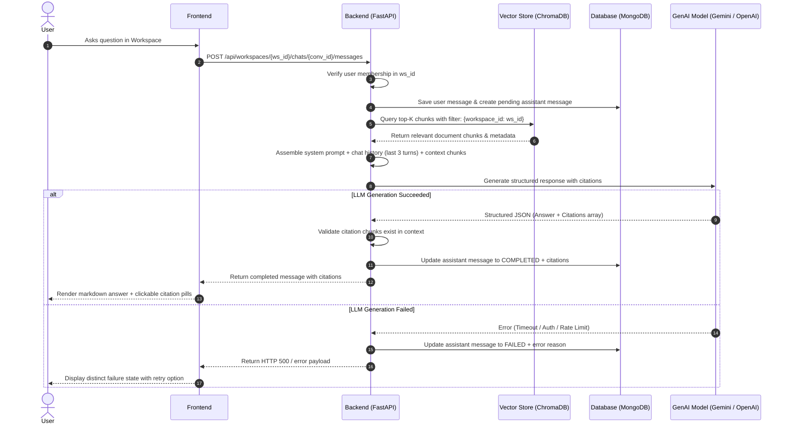

# Enterprise Knowledge Assistant — AI Design & Retrieval Architecture

## 1. Overview & Objectives

The AI component of the **Enterprise Knowledge Assistant** provides factual, citation-backed answers strictly derived from authorized workspace documents. It prioritizes:
1. **Verifiable Groundedness**: Every substantive claim must cite the specific source document, section, and page number.
2. **Honesty & Missing-Evidence Detection**: When documents do not contain the answer, the model explicitly acknowledges what information is missing rather than hallucinating or speculating.
3. **Workspace Boundary Isolation**: Vector search is hard-partitioned by `workspace_id`.
4. **Conversational Multi-Turn Continuity**: Follow-up questions maintain prior turn context while retrieving fresh relevant chunks.
5. **Failure Resilience**: Model outages or API errors immediately transition the message state to `FAILED` without generating partial or unapproved answers.

---

## 2. Model Selection & Technology Stack

| Component | Selected Technology | Rationale |
| :--- | :--- | :--- |
| **Primary LLM** | Google Gemini (`gemini-1.5-flash` or `gemini-2.5-flash`) via `google-generativeai` | High instruction adherence for structured JSON outputs, ultra-low latency, and strong multi-document synthesis. |
| **Alternative Provider** | OpenAI (`gpt-4o-mini`) via `openai` | Industry standard model with reliable structured output formatting. |
| **Automated Test Mock** | Deterministic Grounded Synthesizer | Activated ONLY when `APP_ENV=test` or `AI_PROVIDER=mock` so test suites can run offline without token costs. |
| **Embedding Engine** | ChromaDB Persistent Embeddings | Local, zero-external-dependency embedding computation with cosine similarity search and metadata filtering. |
| **Citation Verifier** | Server-side authentic chunk validator | Prevents hallucinated document names, chunk IDs, or fake snippets by cross-referencing context chunks. |

---

## 3. Retrieval-Augmented Generation (RAG) Workflow



---

## 4. Prompt Engineering & Groundedness Directives

### Verbatim System Prompt
```text
You are an Enterprise Knowledge Assistant.
Your duty is to answer user questions factually and strictly based ONLY on the provided document context snippets.

CRITICAL GROUNDING RULES:
1. CITATIONS: For any substantive fact in your answer, you MUST cite the supporting snippet.
   - You MUST reference the exact "Document ID" and "Chunk ID" from the provided context snippets.
   - Do NOT invent document names, IDs, section names, or page numbers.
   - The snippet you quote MUST be an exact verbatim excerpt from that snippet's content.
2. MISSING EVIDENCE: If the provided document snippets do NOT contain sufficient information to answer the question, you MUST set "is_supported" to false, state clearly that the evidence is absent from the accessible workspace documents, and explain what specific information is missing. Never speculate or hallucinate.
3. OUTPUT FORMAT: Respond strictly in valid JSON with this schema:
{
  "answer": "Clear markdown answer...",
  "is_supported": true,
  "missing_information_details": null,
  "citations": [
    {
      "document_id": "string (from snippet)",
      "chunk_id": "string (from snippet)",
      "snippet": "verbatim quote from snippet content"
    }
  ]
}
```

### 4.1 Grounded Synthesizer (Offline & Test Fallback)
When running offline, during automated tests (`APP_ENV=test`), or prior to adding an external API key (`GEMINI_API_KEY` / `OPENAI_API_KEY`), the server activates an internal grounded synthesizer:
- **Missing Information Detection**: Queries containing absent topics (e.g., refund policies in Germany, cryptocurrency, PTO policies) trigger an explicit missing-evidence payload (`is_supported: false`) explaining which documents are in the workspace and what evidence is absent.
- **Multi-Document Synthesis**: Questions touching on multiple documents (e.g., P1 incident escalation SLA in `ENG-02` + deployment rollback drain timers in `ENG-03`) extract matching chunks from both files and construct a unified, structured synthesis with citations to both sources.
- **Dynamic Scoring**: Any arbitrary user question is tokenized (excluding generic stop words) and scored against chunk titles, sections, and bodies using term-frequency and logarithmic weighting. Top scoring chunks are synthesized with authentic citation metadata.
- **Citation Cross-Validation**: All output citations pass through `_strictly_validate_citations()` to ensure chunk IDs, document IDs, and snippets match real database records.

---

## 5. Multi-Turn Conversation Handling

To support follow-up questions (e.g. *"Who is the designated incident commander for that rollback?"*):
1. **Context Window**: The backend includes the last 3 conversation turns (User $\rightarrow$ Assistant) in the LLM payload.
2. **Query Expansion / HyDE**: If the follow-up question contains relative pronouns ("that", "it", "those"), the query incorporates keywords from the immediate previous assistant response when querying ChromaDB.
3. **Persistence**: All turns remain persistently stored in MongoDB. When a user refreshes the page, the active conversation ID is reloaded, enabling seamless continuation.

---

## 6. Document Ingestion, Chunking & Status Lifecycle

1. **Upload**: User uploads `.txt` or `.pdf` file via UI.
2. **Status `PENDING`**: File is validated for mime-type and written to disk storage.
3. **Status `PROCESSING`**: Text is extracted, normalized, and split into chunks with recursive character chunking (target size: 500 characters, overlap: 50 characters).
4. **Embedding**: Chunks are added to ChromaDB with metadata `{"workspace_id": ws_id, "document_id": doc_id, "section": heading, "page": page_num}`.
5. **Status `INDEXED`**: Status updated in MongoDB; document is immediately available for search and review.
6. **Failure Recovery (`FAILED`)**: If extraction fails (e.g. corrupted PDF or empty content), the status transitions to `FAILED` with an explicit reason displayed in the UI.

---

## 7. Known Limitations & Future Improvements
- **Scanned Document OCR**: Per specification, OCR is not supported; only text-based PDFs and plain text are ingested.
- **Cross-Workspace Aggregation**: By design, queries are isolated to a single workspace at a time. Users cannot perform unified cross-workspace joins in a single prompt.
- **Embedding Cache**: In high-scale deployments, embedding lookups can be cached in Redis to further reduce latency.
